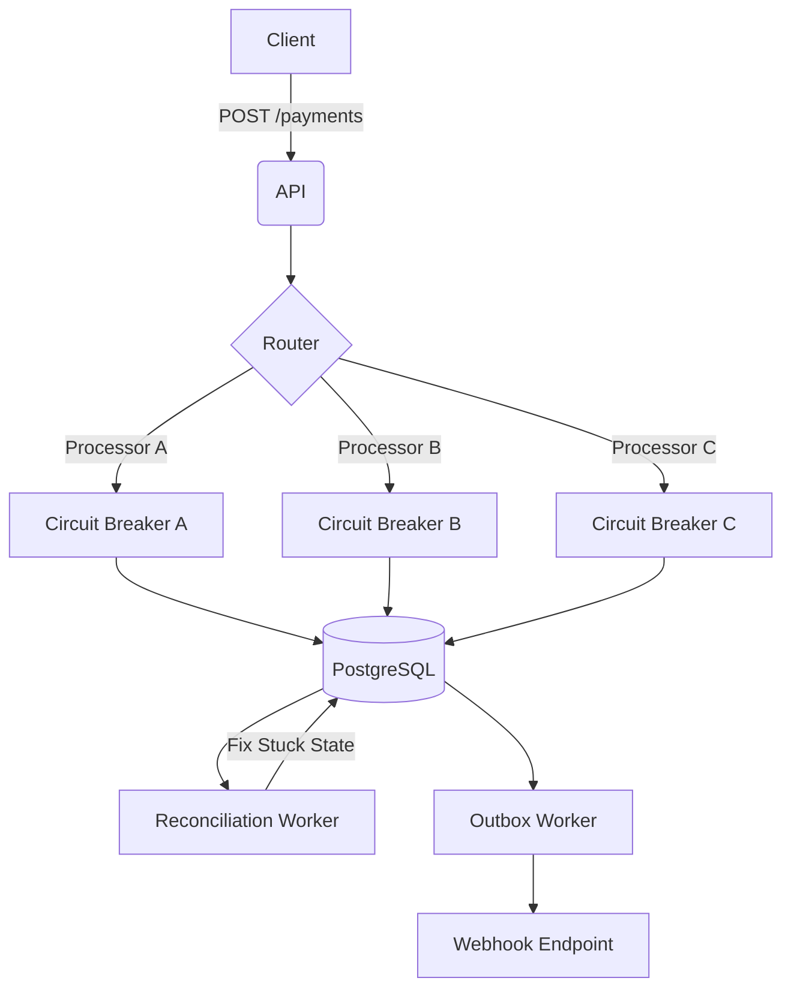

# Payment Orchestrator

A bulletproof, multi-processor payment orchestrator in Python designed to NEVER lose state, double-charge, or corrupt financial balances—even when the database fails, the app crashes, or downstream APIs drop connections.

## Architecture



## Quickstart

1. **Start Services**: `docker-compose up -d db mock-processors`
2. **Migrate**: `alembic upgrade head`
3. **Run App**: `uvicorn app.main:app --port 8000`

## Guarantees

| Guarantee | Enforcing Mechanism | Test |
|-----------|---------------------|------|
| No Double Charges | Idempotency layer (INSERT ON CONFLICT) & DB Constraints | `test_stateful.py` (Hypothesis) |
| Ledger Balance | `debits == credits` constraint at DB level | `audit.sql` & Soak Test |
| Resilient Routing | Rolling success rate queries + Circuit Breakers | `test_router_failover_on_5xx` |
| Safe Ambiguity | Lock + dedicated lookup before failover | `kill_recover_test.py` |
| Guaranteed Webhooks | Transactional Outbox pattern | `test_phase3.py` |

## Proving Invariants
To run the entire suite of stateful testing, chaotic load testing, and assertions:
```
make proof
```
