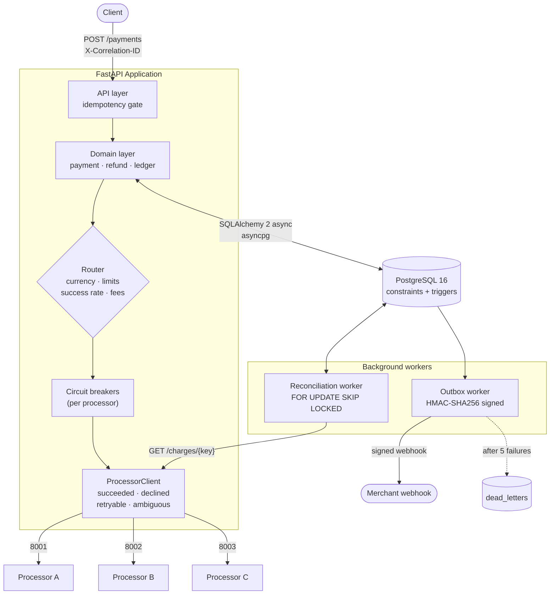
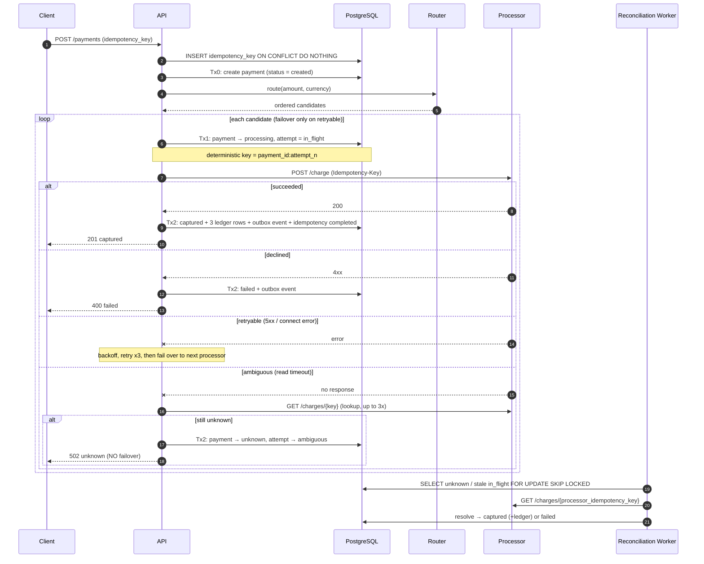
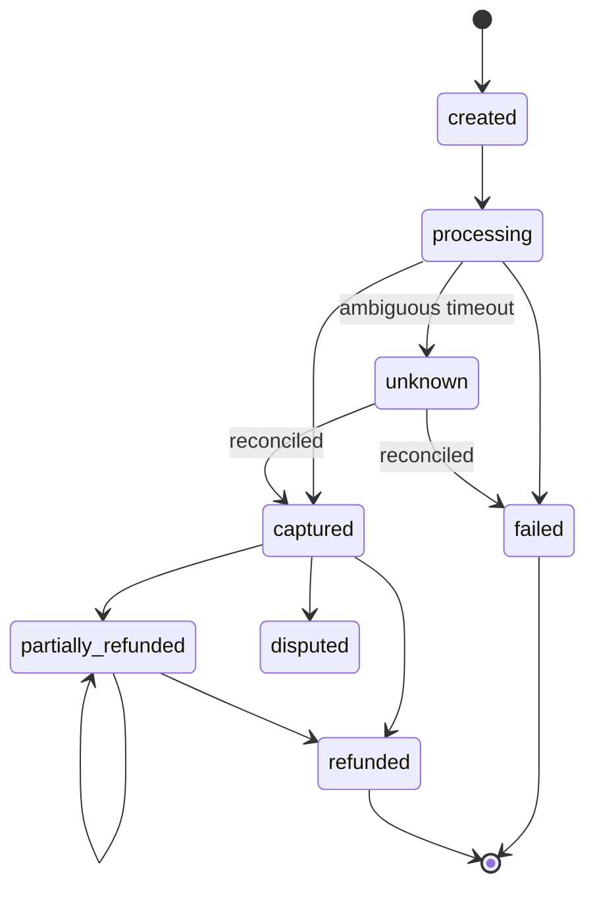
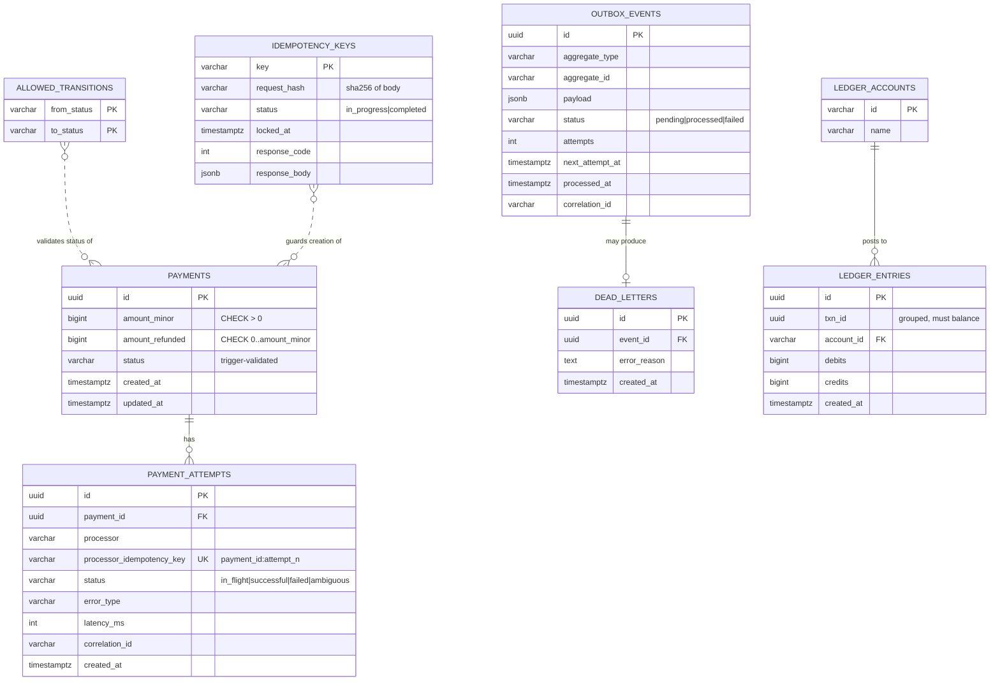
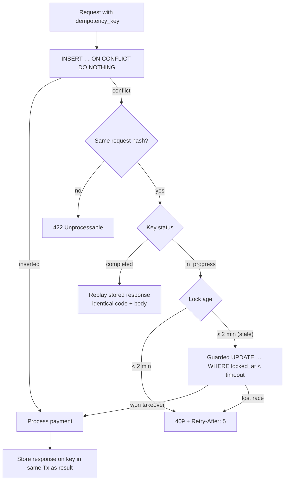
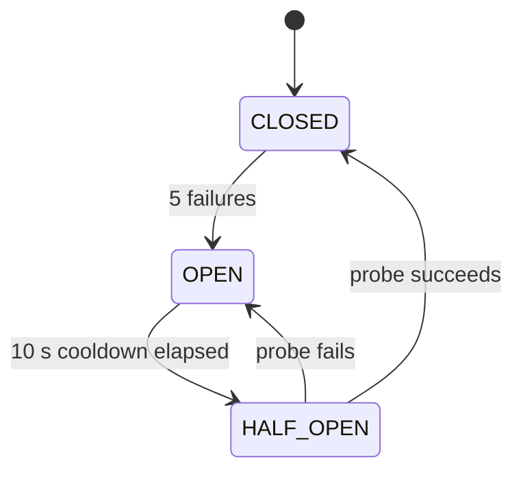
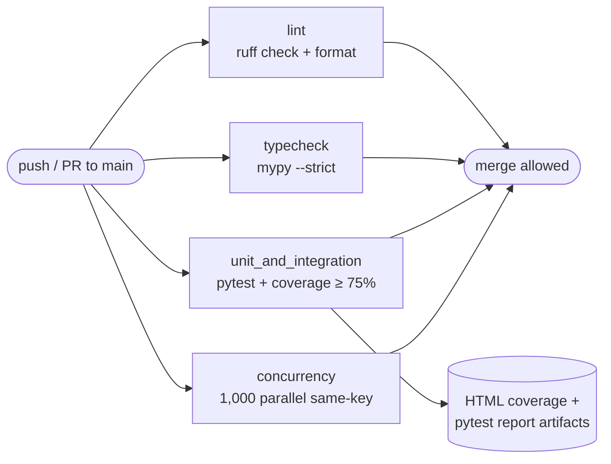

<div align="center">

# 💳 Payment Orchestrator

**A multi-processor payment orchestrator built to never lose state, double-charge, or corrupt the books, even when the app crashes, the network drops, or a processor lies by omission.**


</div>

---

## Table of Contents

1. [Why this exists](#-why-this-exists)
2. [Metrics at a glance](#-metrics-at-a-glance)
3. [Architecture](#-architecture)
4. [The crash-safe charge flow](#-the-crash-safe-charge-flow)
5. [Payment state machine](#-payment-state-machine)
6. [Data model](#-data-model)
7. [Double-entry ledger](#-double-entry-ledger)
8. [Idempotency](#-idempotency)
9. [Routing, retries and circuit breaking](#-routing-retries-and-circuit-breaking)
10. [Transactional outbox and webhooks](#-transactional-outbox-and-webhooks)
11. [Observability](#-observability)
12. [Guarantees and how they are proven](#-guarantees-and-how-they-are-proven)
13. [API reference](#-api-reference)
14. [Quickstart](#-quickstart)
15. [Testing and CI](#-testing-and-ci)
16. [Project structure](#-project-structure)
17. [Design tradeoffs and scaling](#-design-tradeoffs-and-scaling)

---

## 🎯 Why this exists

The hardest question in payments is **"did the charge go through or not?"** A read timeout after the request was sent is neither success nor failure. Naively retrying double-charges the customer; naively failing loses money.

This project makes that ambiguity a first-class state and lets **PostgreSQL itself** enforce the invariants, so a bug in application code cannot produce a double charge, an illegal status change, a rewritten ledger, or an unbalanced transaction.

| Principle | How it is enforced |
|---|---|
| Never double-charge | Idempotency keys (`INSERT … ON CONFLICT`) + deterministic per-attempt processor keys + no failover on ambiguous results |
| Never lose a payment | Two-transaction charge flow + reconciliation worker |
| Books always balance | Deferred constraint trigger: `SUM(debits) = SUM(credits)` per `txn_id` at commit |
| History is immutable | Trigger blocks `UPDATE`/`DELETE` on `ledger_entries` |
| No illegal transitions | Trigger validates every status change against `allowed_transitions` |
| No over-refunds | `CHECK (amount_refunded >= 0 AND amount_refunded <= amount_minor)` |

---

## 📊 Metrics at a glance

> Figures below are taken from the configuration and test suite in this repository. Throughput/latency depend on your hardware; run `make parallel-test` to measure on your machine.

### Correctness and test numbers

| Metric | Value |
|---|---|
| Concurrent same-key requests in the idempotency test | **1,000** → exactly **1** payment created |
| Hypothesis stateful rules | **6** (create, duplicate, refund, 5xx injection, timeout injection, reconcile) |
| Invariants checked after *every* stateful step | **4** (per-txn balance, global balance, no double capture, refunded ≤ captured) |
| Audit queries in `audit.sql` | **6** |
| Soak test | **50** payments under randomly injected 0% / 50% / 100% processor failure rates |
| Coverage gate (CI) | **≥ 75%** (`--cov-fail-under=75`) |
| Type checking | `mypy --strict`, **36** initial errors fixed rather than the config loosened |
| CI jobs required on `main` | **4** (`lint`, `typecheck`, `unit_and_integration`, `concurrency`) |

### Database-level guarantees

| Metric | Value |
|---|---|
| Tables | **8** |
| Alembic migrations | **6** |
| Enforcement triggers | **3** (state machine, ledger append-only, ledger balance) |
| Allowed status transitions | **11** |
| Ledger entries per capture | **3** (always balanced) |

### Resilience parameters

| Parameter | Value |
|---|---|
| Processors | **3** (A, B, C) with distinct fees, currencies, and limits |
| Processor request timeout | **2 s** |
| Retries per processor | **3**, exponential backoff with full jitter (100 ms base, 2 s cap) |
| Ambiguity lookups | up to **3** before deferring to reconciliation |
| Circuit breaker | opens after **5** consecutive failures, **10 s** cooldown, then half-open probe |
| Router success-rate window | rolling **5 min** |
| Idempotency stale-lock timeout | **2 min** |
| Reconciliation picks up stuck `in_flight` attempts older than | **5 s** |
| Webhook delivery | up to **5** attempts, backoff `2^n` s, then dead-letter |
| DB connection pool | **10** + **20** overflow |

---

## 🏗 Architecture



**Layering**

| Layer | Responsibility |
|---|---|
| `app/api` | HTTP, request hashing, idempotency gate, correlation ID |
| `app/domain` | Charge orchestration, refunds, ledger posting, routing, circuit breaker, processor client, outbox publisher |
| `app/db` | SQLAlchemy 2 typed models and async session |
| `app/workers` | Reconciliation and outbox delivery |
| `mock_processors` | Configurable fake processors for chaos testing |

---

## 🔁 The crash-safe charge flow

A charge is split into **two short transactions** around the network call. No database transaction is held open while talking to a processor, and a crash at any point leaves a recoverable record.



**Why failover is forbidden on ambiguity:** if processor A may already have charged the card, sending the same payment to processor B would double-charge. The payment is parked as `unknown` until a lookup proves what happened.

---

## 🔀 Payment state machine

Transitions are stored in the `allowed_transitions` table and checked by a `BEFORE UPDATE OF status` trigger. Anything else raises `Invalid status transition`.



---

## 🗄 Data model



### Database enforcement

| Object | Type | Rule |
|---|---|---|
| `check_payment_status_transition` | `BEFORE UPDATE OF status` trigger | Reject any `(old → new)` not in `allowed_transitions` |
| `trg_block_ledger_update_delete` | `BEFORE UPDATE OR DELETE` trigger | Ledger is append-only |
| `trg_check_ledger_balance` | `CONSTRAINT TRIGGER … DEFERRABLE INITIALLY DEFERRED` | Per-`txn_id` debits must equal credits at commit, otherwise the whole transaction rolls back |
| `payments.amount_minor` | `CHECK` | `> 0` |
| `payments.amount_refunded` | `CHECK` | `>= 0 AND <= amount_minor` |
| `payment_attempts.processor_idempotency_key` | `UNIQUE` | One attempt per processor key |

> Because `DELETE` on the ledger is blocked, tests reset state with `TRUNCATE … CASCADE`.

---

## 📒 Double-entry ledger

Money is never stored as a balance column. It is **derived from immutable debit/credit rows**.

**Capture of 10,000 minor units** (fee model: 2.9% + 30):

| Account | Debit | Credit |
|---|---:|---:|
| `processor_clearing` | 10,000 | |
| `fees_revenue` | | 320 |
| `merchant_payable` | | 9,680 |
| **Total** | **10,000** | **10,000** |

**Partial refund of 4,000** (a new, separate balanced transaction):

| Account | Debit | Credit |
|---|---:|---:|
| `merchant_payable` | 4,000 | |
| `processor_clearing` | | 4,000 |
| **Total** | **4,000** | **4,000** |

Seeded accounts: `customer_funds`, `merchant_payable`, `fees_revenue`, `processor_clearing`.

---

## 🔑 Idempotency



* The request body is canonicalised (`sort_keys`) and SHA-256 hashed, so reusing a key with a different payload is rejected.
* The final response is written in the **same transaction** as the payment outcome, so replays always return exactly what the first caller received.

---

## 🧭 Routing, retries and circuit breaking

**Candidate selection** (`app/domain/router.py`)

1. Filter by supported currency and `max_amount_minor`
2. Drop processors whose circuit breaker is `OPEN`
3. Sort by rolling 5-minute success rate (descending), then fee cost (ascending)

| Processor | Port | Currencies | Max amount (minor) | Base fee | Fee % |
|---|---:|---|---:|---:|---:|
| `processor_a` | 8001 | USD, EUR | 1,000,000 | 10 | 2.9% |
| `processor_b` | 8002 | USD | 500,000 | 5 | 2.5% |
| `processor_c` | 8003 | USD, GBP | 2,000,000 | 20 | 1.5% |

**Result classification** (`ProcessorClient`)

| Outcome | Trigger | Action |
|---|---|---|
| `succeeded` | HTTP 200 | Capture, post ledger |
| `declined` | HTTP 4xx | Fail payment, breaker counts as healthy |
| `retryable` | HTTP 5xx, connection refused, other errors | Backoff and retry, then fail over |
| `ambiguous` | Read timeout after request was sent | Lookup, else park as `unknown`, **never fail over** |

**Circuit breaker**



---

## 📬 Transactional outbox and webhooks

* Domain code inserts an `outbox_events` row **in the same transaction** as the state change, so an event exists if and only if the change committed.
* The outbox worker claims up to **50** due events with `FOR UPDATE SKIP LOCKED`, so multiple workers can run safely.
* Each delivery is signed:

```
Webhook-Timestamp: <unix seconds>
Webhook-Signature: HMAC-SHA256(secret, "<timestamp>.<json body>")
```

| Attempt | Delay before next try |
|---:|---:|
| 1 | 2 s |
| 2 | 4 s |
| 3 | 8 s |
| 4 | 16 s |
| 5 | → `failed` + row in `dead_letters` |

Delivery is **at-least-once**; consumers should de-duplicate on event ID.

---

## 🔭 Observability

* **Structured JSON logs** via `structlog` with ISO timestamps, level, and logger name.
* **Correlation IDs**: `X-Correlation-ID` is read (or generated as UUIDv4), stored in a `ContextVar`, attached to every log line, echoed on the response, forwarded to processors, and persisted on `payment_attempts` and `outbox_events` so workers can continue the same trace asynchronously.
* **Redaction**: `card_number`, `cvv`, `hmac_key`, and `secret` keys are masked in logged payloads.

```json
{"event": "create_payment_request", "correlation_id": "3f1c…", "level": "info",
 "logger": "app.api.endpoints", "timestamp": "2026-10-10T14:29:54Z"}
```

---

## ✅ Guarantees and how they are proven

| Guarantee | Enforcing mechanism | Proof |
|---|---|---|
| No double charge | Idempotency layer, deterministic processor keys, no ambiguous failover | `test_1000_concurrent_requests`, `test_stateful.py`, `parallel_test.py` |
| Balanced ledger | Deferred constraint trigger | `test_unbalanced_ledger_fails`, `audit.sql`, soak test |
| Immutable ledger | Append-only trigger | `test_ledger_update_delete_fails` |
| Legal state transitions | Transition table + trigger | `test_invalid_status_transition` |
| Safe ambiguity | Lookup before any failover; reconciliation worker | `test_charge_then_drop_mode`, `kill_recover_test.py` |
| Crash safety | Two-transaction flow | `test_crash_safety` |
| Resilient routing | Success-rate ranking + circuit breakers | `test_router_failover_on_5xx`, `test_circuit_breaker` |
| Refund bounds | `CHECK` constraint + row lock | `test_refunds`, stateful invariant #4 |
| Guaranteed webhooks | Transactional outbox | `test_phase3.py` |
| Stale lock recovery | Guarded takeover `UPDATE` | `test_stale_lock_recovered` |

### Chaos and proof scripts

| Command | What it does |
|---|---|
| `make test` | Correctness, phase 2 (ambiguity and crash), phase 3 (routing, refunds) |
| `make test-stateful` | Hypothesis state machine with fault injection and invariant checks after every step |
| `make parallel-test` | Fires **1,000** concurrent requests with one key and prints the status distribution |
| `make kill-recover` | `SIGKILL`s the server mid-charge, time-travels the DB, then reconciles |
| `make soak-test` | **50** payments while processors randomly fail at 0 / 50 / 100%, then audits the ledger |
| `make audit` | Runs the 6 SQL invariant queries in `audit.sql` |
| `make proof` | Everything above, in order |

---

## 🔌 API reference

| Method | Path | Description |
|---|---|---|
| `POST` | `/payments` | Create and capture a payment |
| `POST` | `/payments/{payment_id}/refunds` | Full or partial refund |
| `GET` | `/health` | Liveness probe |

### Create a payment

```bash
curl -X POST http://localhost:8000/payments \
  -H "Content-Type: application/json" \
  -H "X-Correlation-ID: demo-123" \
  -d '{"amount_minor": 5000, "idempotency_key": "order-42"}'
```

```json
{
  "id": "6b0f7c1e-…",
  "status": "captured",
  "amount_minor": 5000,
  "charge_id": "ch_48213"
}
```

### Refund

```bash
curl -X POST http://localhost:8000/payments/<payment_id>/refunds \
  -H "Content-Type: application/json" \
  -d '{"amount_minor": 2000, "idempotency_key": "refund-42-a"}'
```

### Status codes

| Code | Meaning |
|---:|---|
| `201` | Captured or refund applied (also returned on idempotent replay) |
| `400` | Declined, invalid payment status, or refund exceeds captured amount |
| `404` | Payment not found (refund) |
| `409` | Same key still in progress; honour `Retry-After: 5` |
| `422` | Idempotency key reused with a different payload |
| `502` | `unknown` (ambiguous, awaiting reconciliation) or all processors failed |
| `503` | No processor available for the currency/amount |

---

## 🚀 Quickstart

**Prerequisites:** Python 3.12, Docker, `psql`.

```bash
# 1. Clone and create a virtualenv
python -m venv venv && source venv/bin/activate
pip install -r requirements.txt

# 2. Start PostgreSQL 16
docker-compose up -d db

# 3. Apply migrations (schema, triggers, seed data)
alembic upgrade head

# 4. Start the three mock processors
for p in 8001 8002 8003; do
  PYTHONPATH=. uvicorn mock_processors.main:app --port $p &
done

# 5. Run the API
uvicorn app.main:app --port 8000
```

### Configuring mock processors

```bash
curl -X POST http://localhost:8001/admin/config \
  -H "Content-Type: application/json" \
  -d '{"latency_ms_min": 50, "latency_ms_max": 150,
       "error_5xx_rate": 0.0, "decline_rate": 0.0,
       "drop_response_mode": true}'
```

| Option | Effect |
|---|---|
| `latency_ms_min/max` | Simulated processing latency |
| `error_5xx_rate` | Probability of HTTP 500 |
| `decline_rate` | Probability of HTTP 400 card decline |
| `drop_response_mode` | **Charges successfully but hangs the response**, producing the ambiguous case |

### Environment

| Variable | Default |
|---|---|
| `DATABASE_URL` | `postgresql+asyncpg://rishi@localhost:5432/payment_orchestrator` |

---

## 🧪 Testing and CI



Mark all four jobs as **required status checks** on `main`.

---

## 📁 Project structure

```
.
├── app/
│   ├── api/endpoints.py          # HTTP routes + idempotency gate
│   ├── db/
│   │   ├── models.py             # SQLAlchemy 2 typed models
│   │   └── session.py            # async engine and session maker
│   ├── domain/
│   │   ├── payment.py            # crash-safe charge orchestration
│   │   ├── refund.py             # refunds with row locks
│   │   ├── ledger.py             # double-entry posting
│   │   ├── router.py             # processor selection
│   │   ├── circuit_breaker.py    # per-processor breaker
│   │   ├── processor_client.py   # result classification
│   │   └── outbox.py             # event publishing
│   ├── workers/
│   │   ├── reconciliation.py     # resolves unknown / stuck payments
│   │   └── outbox.py             # signed webhook delivery + DLQ
│   ├── logging.py                # structlog + correlation IDs + redaction
│   └── main.py                   # app factory + middleware
├── mock_processors/main.py       # chaos-capable fake processors
├── migrations/                   # 6 Alembic revisions
├── scripts/                      # parallel, soak, kill-recover
├── tests/                        # correctness, phase 2/3, stateful, ops
├── docs/                         # per-phase notes, design, Hyperswitch comparison
├── audit.sql                     # 6 invariant queries
└── Makefile
```

---

## ⚖️ Design tradeoffs and scaling

| Decision | Benefit | Cost |
|---|---|---|
| Invariants in Postgres, not just app code | Correct regardless of app bugs or rogue workers | Business rules live in migrations; heavier schema changes |
| Postgres outbox instead of direct publish | No lost events on crash | Polling delay; separate worker |
| Polling reconciliation | Catches silent failures such as OOM kills | Resolution delayed by poll interval |
| Row locks instead of distributed locks | No Redis dependency for correctness | Contention on hot rows at very high scale |

**Scaling path**

1. Partition `ledger_entries` and `payment_attempts` by month
2. Replace outbox polling with CDC (Debezium + Kafka)
3. Move `idempotency_keys` to a low-latency KV store (Redis / DynamoDB)
4. Add per-merchant sub-ledgers and rollups on read replicas

See [`docs/design.md`](docs/design.md) and [`docs/hyperswitch_comparison.md`](docs/hyperswitch_comparison.md) for the full reasoning.

---

## 📚 Further reading

* [`docs/phase-1.md`](docs/phase-1.md): correctness core
* [`docs/phase-2.md`](docs/phase-2.md): processors and the ambiguous timeout
* [`docs/phase-3.md`](docs/phase-3.md): routing, resilience, refunds, outbox
* [`docs/ops-phase-1.md`](docs/ops-phase-1.md): CI and structured logging

---

<div align="center">

Built around one idea: **make the database the last line of defence, so correctness never depends on every line of application code being right.**

</div>
